<div align="center">

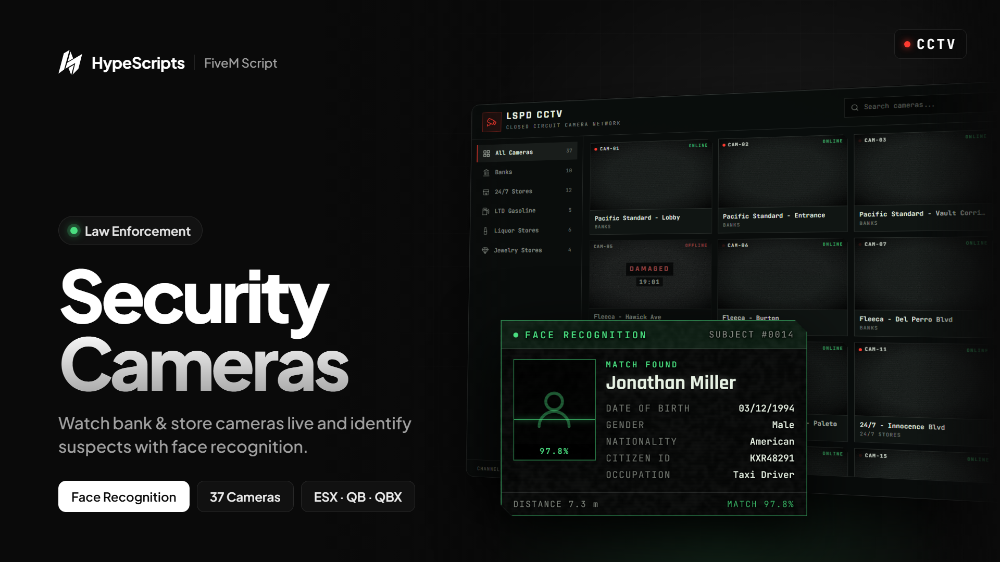

# hype-camera

**CCTV system with face recognition for FiveM**

Authorized players watch security cameras in banks, stores and shops from police station terminals,
steer and zoom them in real time and identify unmasked suspects through face recognition.


[Features](#features) · [Screenshots](#screenshots) · [Installation](#installation) · [Configuration](#configuration) · [Controls](#controls) · [Developers](#developers)

</div>

---

## Features

| | |
| --- | --- |
| **37 ready cameras** | Pacific Standard, every Fleeca, Blaine County Savings, 24/7, LTD, Rob's Liquor and Vangelico, grouped into categories. Adding your own takes one line. |
| **Pan, tilt & zoom** | Steer every camera with <kbd>W</kbd><kbd>A</kbd><kbd>S</kbd><kbd>D</kbd> and zoom smoothly with the mouse wheel, within per-camera FOV and turning limits. |
| **Face recognition** | Hold the crosshair on a player to scan their face and pull their record: name, date of birth, gender, nationality, ID, occupation and phone. |
| **Masks & disguises** | Masked players, configured helmets and glasses, and players facing away cannot be identified. Recognition range grows as you zoom in. |
| **Detection log** | Every identified and masked subject is logged on screen with time and camera. |
| **Destructible cameras** | Shooting a camera takes it offline for a configurable time, with sparks and a live countdown. Map CCTV props are used, or one is placed when missing. |
| **Live terminals** | A searchable camera list at the station computers, with category filters, online status and realistic *connecting* and *signal lost* states. |
| **Access control** | Job and grade based permissions, optional duty requirement and an admin ace bypass. Access, recognition and camera hits are all validated on the server. |
| **Developer friendly** | Client and server exports, a camera destroyed event and a live `GlobalState` of offline cameras. |
| **Optimized** | Idle while the cameras are closed; the viewer only sends interface updates when something changes. |

## Screenshots

<table>
  <tr>
    <td width="50%">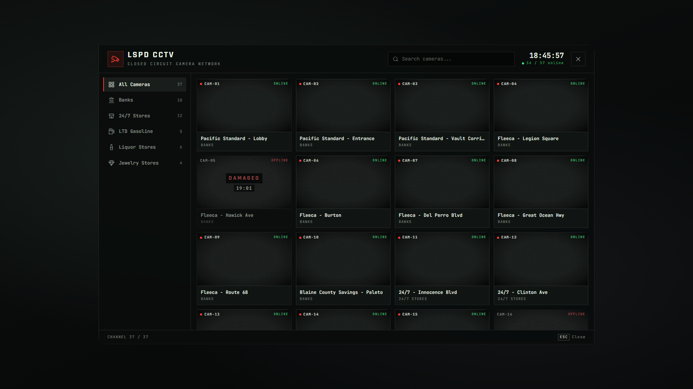</td>
    <td width="50%">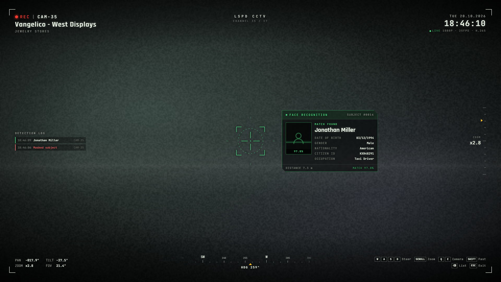</td>
  </tr>
  <tr>
    <td align="center"><sub>Camera list</sub></td>
    <td align="center"><sub>Face recognition match</sub></td>
  </tr>
  <tr>
    <td>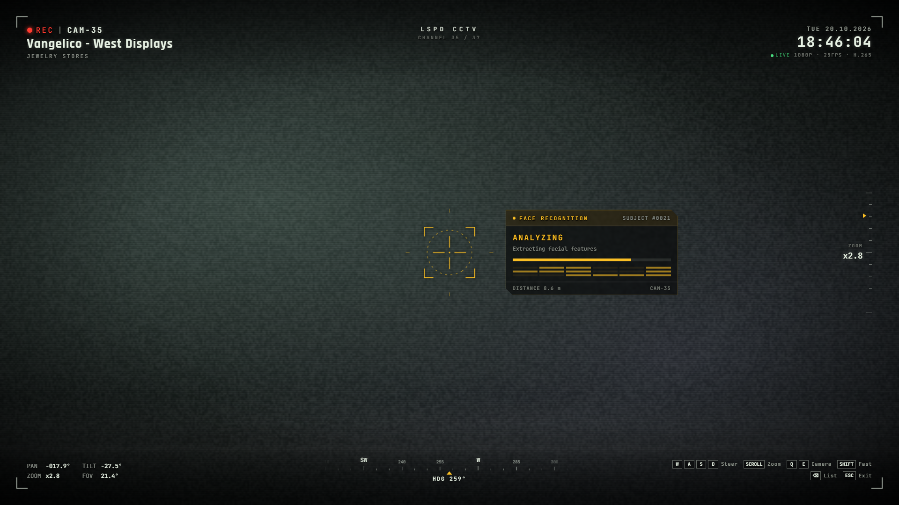</td>
    <td>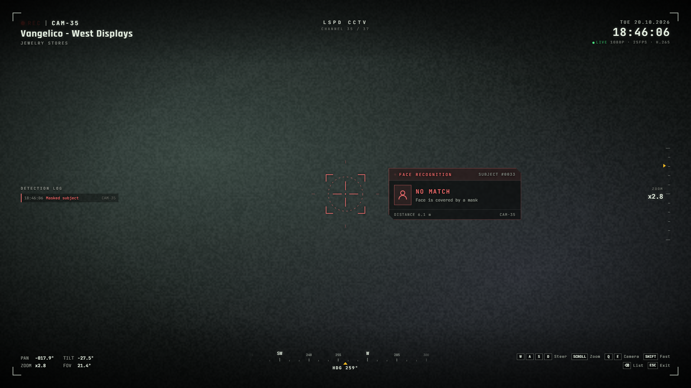</td>
  </tr>
  <tr>
    <td align="center"><sub>Scanning a face</sub></td>
    <td align="center"><sub>Masked subject</sub></td>
  </tr>
</table>

<details>
<summary><b>More screenshots</b></summary>
<br>

<table>
  <tr>
    <td width="50%">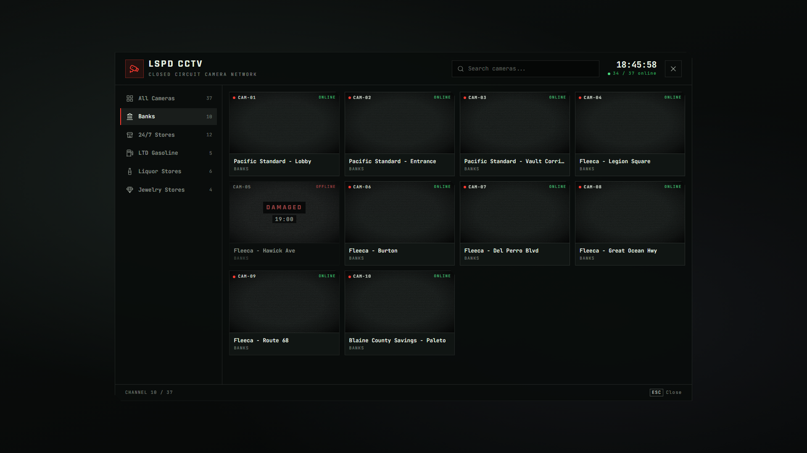</td>
    <td width="50%">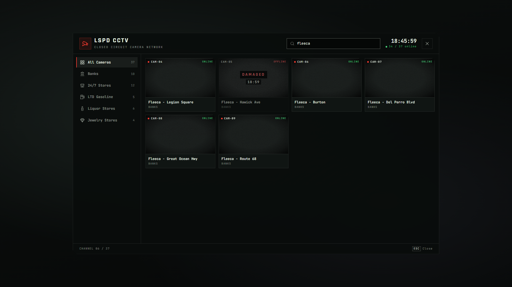</td>
  </tr>
  <tr>
    <td align="center"><sub>Category filter</sub></td>
    <td align="center"><sub>Search by camera or location</sub></td>
  </tr>
  <tr>
    <td></td>
    <td>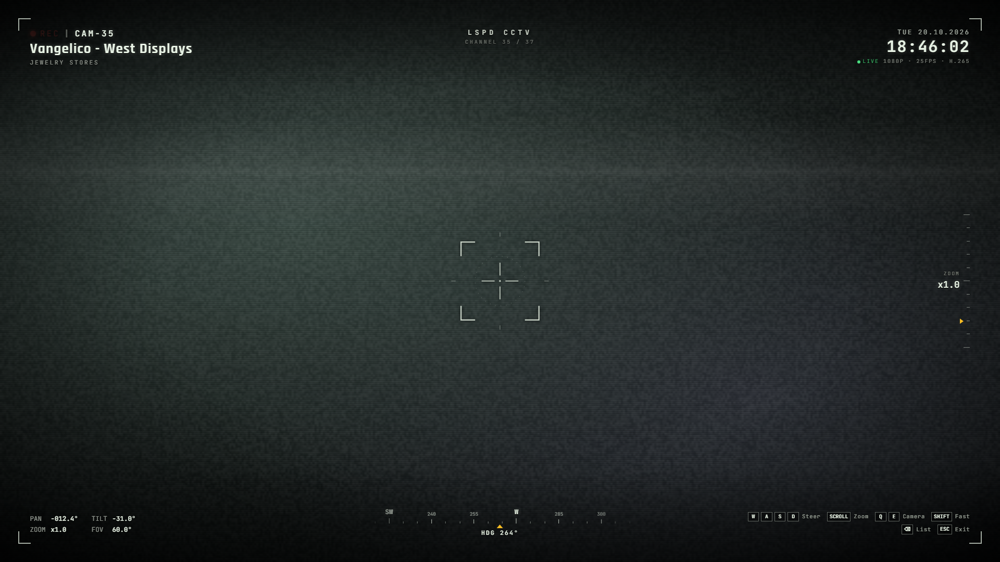</td>
  </tr>
  <tr>
    <td align="center"><sub>Connecting to a camera</sub></td>
    <td align="center"><sub>Camera view</sub></td>
  </tr>
  <tr>
    <td>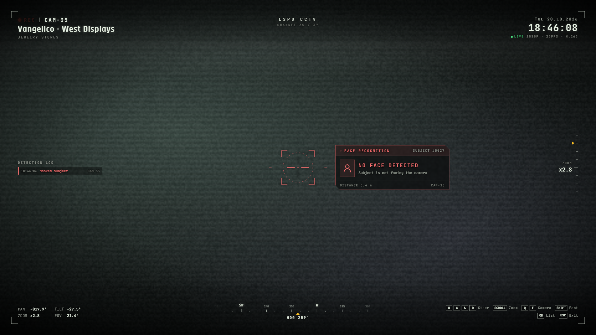</td>
    <td>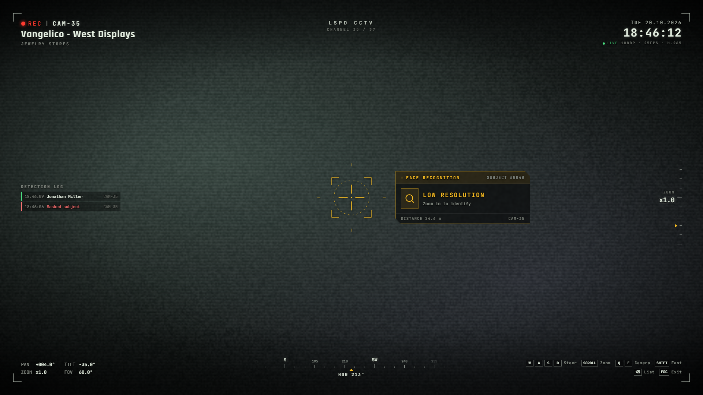</td>
  </tr>
  <tr>
    <td align="center"><sub>Subject facing away</sub></td>
    <td align="center"><sub>Too far, zoom in</sub></td>
  </tr>
  <tr>
    <td>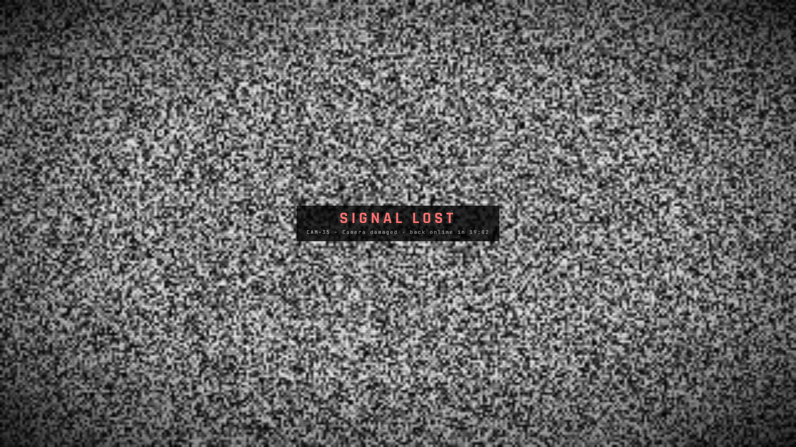</td>
    <td>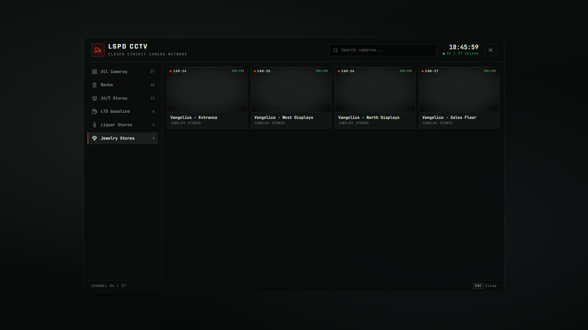</td>
  </tr>
  <tr>
    <td align="center"><sub>Camera shot out</sub></td>
    <td align="center"><sub>Jewelry store cameras</sub></td>
  </tr>
</table>

</details>

## Requirements

| Type | Supported | Notes |
| --- | --- | --- |
| Required | [`ox_lib`](https://github.com/overextended/ox_lib/releases/latest) | The only hard dependency |
| Framework | `qbx_core`, `qb-core`, `es_extended` | Detected automatically |
| Target | `ox_target`, `qb-target` | Needed for the station terminals |
| Notifications | `ox_lib`, `okokNotify`, `ps-ui` | Picked automatically or forced in the config |

> [!NOTE]
> On ESX, face recognition reads the `esx_identity` fields. Nationality and phone are only shown
> when another resource stores them on the player (`xPlayer.set('nationality', ...)`, `xPlayer.set('phoneNumber', ...)`).

## Installation

> [!IMPORTANT]
> The resource folder **must** be named `hype-camera`, otherwise exports and NUI callbacks will not resolve.

**1. Download** or clone this repository and place it in your `resources` folder.

**2. Start it** in `server.cfg`, after its dependencies:

```cfg
ensure ox_lib
ensure qbx_core          # or qb-core / es_extended
ensure ox_target         # or qb-target
ensure hype-camera
```

**3. Configure** `config/config.lua`: at least the job groups and terminal coordinates (see below).

**4. Set the language** (`en` and `tr` included, add more in `locales/`):

```cfg
setr ox:locale "en"
```

## Configuration

Everything lives in [`config/config.lua`](config/config.lua) and [`config/cameras.lua`](config/cameras.lua). The most important options:

| Option | Description |
| --- | --- |
| `Access` | Jobs and minimum grades allowed to watch, the duty requirement and an ace that bypasses the job check |
| `Terminals` | Station computers where the cameras can be watched |
| `Command` | Optional command that opens the camera list (`false` = terminals only) |
| `AdminCommand` | Admin command that switches a camera on or off (`false` = disabled) |
| `Controls` / `Defaults` | Rotation speed, zoom steps and the default FOV, pan and tilt limits |
| `Destroy` | Shootable cameras: offline duration, hit radius, fallback prop and effects |
| `Recognition` | Recognition range, scan time, facing check and the fields shown |
| `Mask` / `FaceProps` | Drawables and props that hide a player's face |
| `Filter` | Picture effect (timecycle modifier) and its strength |
| `UI` | Brand name, date locale and real or in-game clock |
| `Categories` | Categories of the camera list, with their icons |

<details>
<summary><b>Example: access and terminals</b></summary>

```lua
Access = {
    groups = { police = 0, sheriff = 0 },  -- job name -> minimum grade
    requireDuty = true,
    ace = "group.admin",                   -- false = disabled
},

Terminals = {
    { coords = vec3(441.85, -978.92, 30.69), radius = 0.8, label = "Mission Row PD" },
    { coords = vec3(1853.18, 3689.62, 34.27), radius = 0.8, label = "Sandy Shores Sheriff" },
    { coords = vec3(-448.29, 6011.95, 31.72), radius = 0.8, label = "Paleto Bay Sheriff" },
},
```

</details>

<details>
<summary><b>Example: adding a camera</b></summary>

```lua
-- config/cameras.lua
{ id = "mrpd_lobby", label = "Mission Row - Lobby", category = "bank",
  coords = vec3(441.2, -981.9, 32.9), rot = vec3(-25.0, 0.0, 90.0),
  fov = 55.0, limits = { yaw = 60.0 } },
```

Set `Debug = true`, aim an existing camera with WASD and press <kbd>C</kbd>, or fly there with noclip
and run `/camerapos`: the `coords` / `rot` line is copied to your clipboard.

</details>

## Controls

While watching a camera:

| Key | Action |
| --- | --- |
| <kbd>W</kbd> <kbd>A</kbd> <kbd>S</kbd> <kbd>D</kbd> | Pan and tilt |
| <kbd>Shift</kbd> | Move faster |
| Mouse wheel | Zoom |
| <kbd>Q</kbd> / <kbd>E</kbd> or <kbd>←</kbd> / <kbd>→</kbd> | Previous / next camera |
| <kbd>Backspace</kbd> | Back to the camera list |
| <kbd>ESC</kbd> | Close the viewer |

## Developers

All exports are called through `exports["hype-camera"]`.

| Export | Side | Description |
| --- | --- | --- |
| `Open()` / `Close()` | client | Open or close the camera list (e.g. from an MDT or tablet) |
| `IsOpen()` | client | Whether the viewer is open |
| `GetViewingCamera()` | client | ID of the camera being watched |
| `SetCameraOnline(id, online)` | server | Switch a camera on or off (e.g. cut the cameras during a robbery) |
| `DestroyCamera(id, duration?)` | server | Take a camera offline as damaged for `duration` seconds |
| `IsCameraOnline(id)` | server | Whether a camera is online |
| `GetViewers(id?)` | server | Players watching a camera, or any camera |

```lua
-- Server: alert dispatch when a camera is shot
AddEventHandler("hype-camera:server:cameraDestroyed", function(id, source, coords, label) end)

-- Both sides: offline cameras (read only). true = switched off, number = os.time it comes back
local offline = GlobalState["hype-camera:offline"]
```

<details>
<summary><b>Building the UI</b></summary>

The interface ships prebuilt in `web/build`. To modify it, edit the Vue source in `web/` and rebuild:

```bash
cd web
pnpm install
pnpm build
```

</details>

## License

Released under the [MIT License](LICENSE).

<div align="center">
<sub>Made by <b>HypeScripts</b></sub>
</div>
